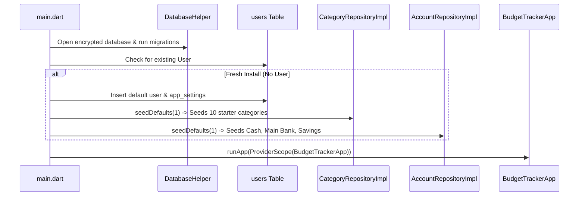

# System Architecture & Clean Architecture Blueprint

This document details the architectural boundaries, unidirectional data flow, persistence layer, and local AI orchestration for the **Budget Tracker** application.

---

## 1. Architectural Layers & Boundaries

Budget Tracker follows strict **Clean Architecture** separation of concerns:

```
┌────────────────────────────────────────────────────────┐
│                   Presentation (UI)                     │
│  • Screens (Home, Transactions, Budgets, Goals, AI)    │
│  • Components (TactileBounce, FinancialSummaryCard)    │
│  • State Providers (Riverpod Notifiers & AsyncValues)  │
└───────────────────────────┬────────────────────────────┘
                            │ Dispatches User Actions / Watches State
                            ▼
┌────────────────────────────────────────────────────────┐
│                   Domain Services                      │
│  • FinancialCalculator (Net Worth, Cash Flow, Budgets) │
│  • AIOrchestrator (Tool dispatching, prompt routing)   │
│  • Validation engines & integer-cent financial math    │
└───────────────────────────┬────────────────────────────┘
                            │ Invokes Repository Contracts
                            ▼
┌────────────────────────────────────────────────────────┐
│              Domain Repositories (Interfaces)           │
│  • AccountRepository, TransactionRepository            │
│  • CategoryRepository, BudgetRepository, GoalRepo      │
└───────────────────────────┬────────────────────────────┘
                            │ Implemented by Data Layer
                            ▼
┌────────────────────────────────────────────────────────┐
│                   Data & Storage                       │
│  • DatabaseHelper (Encrypted SQLite via SQLCipher)     │
│  • Repository Implementations & Default Seed Handlers  │
│  • Schema Migrations & Defensive Deserialization       │
└────────────────────────────────────────────────────────┘
```

---

## 2. Unidirectional Data Flow

Every state change flows in a single direction to eliminate inconsistent UI states:

$$\text{User Action / Input} \longrightarrow \text{Riverpod Notifier} \longrightarrow \text{Repository Execution} \longrightarrow \text{SQLite Commit} \longrightarrow \text{State Invalidation \& UI Re-render}$$

- **No Business Logic in Views:** Flutter widgets never compute net cash flows, savings rates, or budget warnings directly in `build()` methods. All calculations delegate to `FinancialCalculator`.
- **Shared Calculator with AI:** Both the UI screens and the on-device AI tools query the exact same `FinancialCalculator` instance, guaranteeing that the AI assistant never reports numbers that conflict with the dashboard.

---

## 3. Bootstrap & Seeding Protocol

On cold start (`lib/main.dart`), the application executes a safe startup sequence:



---

## 4. Local AI Tool Architecture

The AI Assistant runs entirely on-device with zero cloud transmission:

1. **Tool Registry:** Exposes typed financial inspection and aggregation tools (`get_balance`, `get_transactions`, `get_budget_status`, `calculate_affordability`).
2. **Deterministic Rules & Local Model:** Analyzes user queries via intent recognition and invokes registered tools through clean repository adapters.
3. **Response Validation:** Sanitizes dynamic inputs and prevents hallucinated financial data before presenting results to the user.
